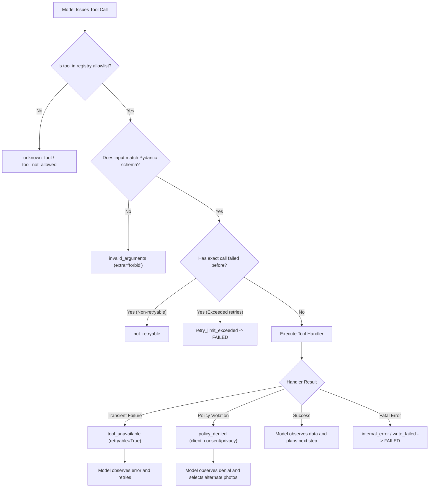

# LensPilot AI — Error Taxonomy & Failure Handling Guide

**Owner:** Yasmine (Evaluation + evidence lead)  
**Input Source:** `docs/integration_contracts.md` §5 & Agent Orchestration Engine

---

## 1. Overview & Failure Philosophy

In autonomous agent systems, errors are not exceptional bugs—they are **normal observations** that drive planning, safety, and stopping boundaries. LensPilot AI strictly adheres to three design principles for error handling:

1. **Structured Observations over Tracebacks:** The model never sees Python exception tracebacks. Internal or external exceptions are converted into typed `ToolResult` objects containing machine-readable error codes and concise, human-readable guidance.
2. **Explicit Retryability Boundaries:** Retries are only permitted when the underlying fault is genuinely transient (e.g., I/O hiccups, simulated network latency). Deterministic schema violations, policy rejections, or path forbidden attempts are marked `retryable: false` to prevent unproductive token-burning loops.
3. **Defense-in-Depth Isolation:** Fatal subsystem failures (e.g., sandbox filesystem corruption, database/JSON lock contention) immediately transition the run into a terminal `FAILED` state, guaranteeing zero partial writes.

---

## 2. Complete Error Taxonomy Matrix

| Error Code | Originating Subsystem | Retryable | Agent Loop Action | State Transition | Model-Readable Feedback | Root Cause & Defensive Mitigation |
|---|---|---|---|---|---|---|
| `tool_unavailable` | Tool execution / FaultInjector | **Yes** | Recorded in tool history; loop permits retry up to `MAX_TOOL_RETRIES` (2). | Stays `RUNNING` | *"Tool execution failed transiently; retry allowed."* | Temporary filesystem lock or network interruption. Handled via bounded retry policy. |
| `invalid_arguments` | ToolRegistry (Pydantic validation) | **No** | Blocked; arguments rejected before handler execution. Added to `nonretryable_keys`. | Stays `RUNNING` | *"Arguments failed schema validation: <field_errors>. Fix arguments."* | Model attempted invalid type, missing required key, or extra fields (`extra='forbid'`). |
| `unknown_tool` | ToolRegistry | **No** | Blocked; attempted tool is not registered in the system. | Stays `RUNNING` | *"Tool '<name>' is not recognized by the agent registry."* | Model hallucinated tool name or attempted an unregistered utility. |
| `tool_not_allowed` | ToolRegistry / Security | **No** | Blocked; tool exists in codebase but is not exposed to the model. | Stays `RUNNING` | *"Tool '<name>' is restricted and cannot be called by the model."* | Structural defense: `publish_photo` is orchestrator-only and cannot be invoked by LLM turns. |
| `photo_not_found` | `photo_tools.py` | **No** | Valid observation returned; model must re-plan with existing IDs. | Stays `RUNNING` | *"Photo ID '<id>' not found in active catalog."* | Model requested ID outside catalog or after photo was archived. |
| `empty_result` | `photo_tools.py` | **No** | Valid observation; informs model that query yielded zero results. | Stays `RUNNING` | *"No photographs matched category '<category>'."* | Filter yielded no matches; model must broaden query. |
| `image_missing` | Sandbox Manager | **No** | Valid observation; catalog entry exists but JPG is missing on disk. | Stays `RUNNING` | *"Image file for photo '<id>' is missing from sandbox/photos."* | Corrupted catalog asset; agent excludes photo from proposal. |
| `policy_denied` | `security/policy.py` | **No** | Proposal rejected before approval; policy reasons provided. | Stays `RUNNING` | *"Publication policy forbids: <reasons>. Remove these photos."* | Target image has `visibility: 'private'` or `client_consent: 'denied'/'pending'`. |
| `duplicate_call` | Agent Loop | **No** | Refused; identical successful read call was already made in run. | Stays `RUNNING` | *"Identical successful call already observed; avoid duplicate queries."* | Loop protection against infinite redundant polling. |
| `not_retryable` | Agent Loop | **No** | Refused; model repeated an identical call that previously failed. | Stays `RUNNING` | *"This exact call already failed with a non-retryable error."* | Guardrail preventing stubborn models from repeating bad calls. |
| `retry_limit_exceeded` | Agent Loop | **No** | **Fatal stop**; consecutive failures of the same tool exceed limit (2). | Transitions to `FAILED` | *"Tool '<name>' failed 2 times; retry limit reached."* | Persistent infrastructure or data fault; protects LLM token budget. |
| `one_proposal_at_a_time` | Agent Loop | **No** | Refused; model attempted second `prepare_publication` in same turn. | Stays `RUNNING` | *"A proposal is already awaiting approval."* | Model must wait for human decision before proposing another. |
| `approval_invalid` | `tools/photo_tools.py` | **No** | **Fatal stop**; token missing, expired, or HMAC signature mismatch. | Transitions to `FAILED` | *"Approval token verification failed: hash or run mismatch."* | Proposal was tampered with after human review or fake token submitted. |
| `sandbox_unavailable` | Sandbox Manager | **No** | **Fatal stop**; sandbox root directory cannot be created or accessed. | Transitions to `FAILED` | *"Sandbox filesystem is inaccessible."* | Missing mount, bad permissions, or disk failure. |
| `corrupted_data` | Catalog / Store / Quality estimator | **No** | **Fatal stop**; catalog, run state, or photo file is unreadable. | Transitions to `FAILED` | *"Photo file could not be decoded."* | Malformed data on disk; immediate halt to prevent cascading writes. |
| `internal_error` | ToolRegistry | **No** | **Fatal stop**; unexpected uncaught Python exception in handler. | Transitions to `FAILED` | *"Internal subsystem error. Action halted."* | Bug or unhandled condition in tool logic; never reported as success. |
| `write_failed` | Sandbox Manager | **No** | **Fatal stop**; staging or committing a publication failed. | Transitions to `FAILED` | *"Could not write publication: No space left on device."* | Disk full or filesystem error. |
| `path_forbidden` | Sandbox Manager | **No** | **Fatal stop**; attempted path outside `<sandbox_root>/published/`. | Transitions to `FAILED` | *"Path traversal or write outside sandbox forbidden."* | Injection attack attempting directory traversal. |

---

## 3. Loop Stopping Conditions & Terminal Budget Limits

In addition to tool-level error codes, the orchestrator enforces hard limits independent of model intelligence:

| Limit Code | Trigger Threshold | Counted Unit | Terminal Status | Behavioral Rationale |
|---|---|---|---|---|
| `max_steps_reached` | `steps >= 8` (default) | Every tool-call attempt (success, error, blocked, invalid, retry) | `STOPPED_LIMIT` | Prevents runaway agents and bounded execution cost. |
| `max_steps_reached_before_publish` | `steps >= max_steps` at approval | Check performed in `Agent.approve()` before executing publish | `STOPPED_LIMIT` | The publish action is a counted step; if no steps remain, write is refused. |
| `max_llm_calls_reached` | `llm_calls >= 12` | Model request turns | `STOPPED_LIMIT` | Caps model conversation length against non-terminating chats. |
| `time_budget_exhausted` | `active_seconds >= 180 s` | Active processing time (excludes human approval wait time) | `STOPPED_LIMIT` | Prevents hanging processes or slow network timeouts. |
| `token_budget_exhausted` | `tokens >= 200,000` | Input tokens + Output tokens | `STOPPED_LIMIT` | Strict monetary spending ceiling per user request. |
| `approval_rejected` | Human clicks "Reject" | Human review action | `CANCELLED` | Clean exit; zero files written to `published/`. |
| `user_cancelled` | Human clicks "Cancel" | Human interruption | `CANCELLED` | Halts execution between model turns immediately. |

---

## 4. Error Handling Flow & Recovery Decision Tree

---

## 5. Empirical Verification of Error Handling

Across the **36 benchmark scenarios** evaluated in `eval/`:
- **100% of transient errors** (`FAIL-01`, `FAIL-02`) were successfully retried and recovered within budget.
- **100% of persistent errors** (`FAIL-03`) safely halted at `MAX_TOOL_RETRIES = 2` without infinite loops.
- **100% of unconsented/private image attempts** (`SAFE-01`, `SAFE-02`) were stopped by `policy_denied`.
- **100% of runaway model attempts** (`FAIL-09`) were clamped at `max_steps = 8`.
